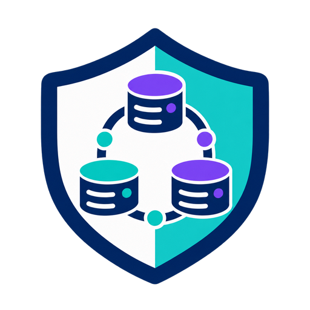

<p align="center">
  
</p>

# Kafka Broker Discovery System

A Java library that provides automatic Kafka broker discovery and security configuration for Kafka producers and consumers. The system consists of a discovery server that provides broker metadata via REST APIs and a client library that uses this metadata to configure standard Kafka clients that communicate **directly** with Kafka brokers.

## Architecture

The system is split into two main components:

### 🖥️ **Discovery Server**
- Provides REST APIs for broker discovery and metadata lookup
- Stores topic metadata including broker locations and security configurations
- Supports multiple environments (dev, staging, production)
- Health monitoring and administrative endpoints

### 📱 **Discovery Client**
- Looks up broker configurations and security settings from the discovery server
- Creates standard Kafka producers/consumers that communicate **directly** with Kafka brokers
- Supports interceptors for debugging and message augmentation
- Automatically configures security settings (SSL, SASL, etc.)

## Project Structure

```
src/main/java/com/example/kafka/discovery/
├── server/                          # Discovery server components
│   ├── BrokerDiscoveryService.java  # REST API service
│   ├── TopicMetadataStore.java      # Metadata storage
│   └── DiscoveryServerApplication.java  # Standalone server app
├── client/                          # Discovery client components
│   ├── KafkaDiscoveryClient.java    # Main client API
│   ├── KafkaDiscoveryProducer.java  # Discovery-enabled producer wrapper
│   ├── KafkaDiscoveryConsumer.java  # Discovery-enabled consumer wrapper
│   ├── RestKafkaMetadataService.java # REST client implementation
│   └── RestClientConfig.java        # REST client configuration
├── common/                          # Shared components
│   ├── TopicMetadata.java           # Topic metadata model
│   ├── KafkaMetadataService.java    # Metadata service interface
│   ├── ProducerInterceptor.java     # Producer interceptor interface
│   ├── ConsumerInterceptor.java     # Consumer interceptor interface
│   └── interceptors/                # Built-in interceptors
└── examples/                        # Usage examples
    └── FullIntegrationExample.java  # Complete demonstration
```

## Quick Start

### 1. Start Local Kafka (Optional)

If you want to test with real Kafka:

```bash
# Start Kafka using Docker Compose
docker-compose up -d

# Verify Kafka is running
docker-compose ps
```

This will start:
- Kafka on `localhost:9092`
- Kafka UI on `http://localhost:8081`
- Pre-created topics: `dev-topic`, `prod-topic`, `staging-topic`

### 2. Run the Server Application

```bash
# Start the discovery server
mvn exec:java -Dexec.mainClass="com.example.kafka.discovery.server.DiscoveryServerApplication"

# Or with custom port
mvn exec:java -Dexec.mainClass="com.example.kafka.discovery.server.DiscoveryServerApplication" -Dexec.args="8080"
```

The server will start on port 8080 (or specified port) and provide these endpoints:
- `GET /health` - Health check
- `GET /api/topics` - List all topics
- `GET /api/topics/{name}` - Get topic metadata
- `GET /api/admin/stats` - Service statistics

### 3. Run the Full Integration Example

```bash
# Run the comprehensive example
mvn exec:java -Dexec.mainClass="com.example.kafka.examples.FullIntegrationExample"
```

This example demonstrates:
✅ Starting the discovery service  
✅ Creating a discovery client  
✅ Automatic broker configuration retrieval  
✅ Creating Kafka producers/consumers  
✅ Message interceptors and debugging  
✅ Error handling and cleanup  

## Usage Examples

### Basic Client Usage

```java
// Create a discovery client
KafkaDiscoveryClient client = new KafkaDiscoveryClient("http://localhost:8080");

// Create a producer with automatic broker discovery
// This looks up broker addresses and security config, then creates a standard Kafka producer
KafkaDiscoveryProducer<String, String> producer = client.createProducer("my-topic");

// Send messages normally - producer talks directly to Kafka brokers
producer.send(new ProducerRecord<>("my-topic", "key", "value"));

// Create a consumer with automatic broker discovery
// This looks up broker addresses and security config, then creates a standard Kafka consumer
KafkaDiscoveryConsumer<String, String> consumer = client.createConsumer("my-topic", "my-group");

// Consume messages normally - consumer talks directly to Kafka brokers
consumer.subscribe(Arrays.asList("my-topic"));
ConsumerRecords<String, String> records = consumer.poll(Duration.ofSeconds(1));
```

### With Debug Mode

```java
// Enable debug mode for detailed logging and interceptors
KafkaDiscoveryClient client = new KafkaDiscoveryClient("http://localhost:8080", true);

// Producers/consumers will automatically include:
// - Logging interceptors for message tracking
// - Message augmentation (timestamps, client IDs, etc.)
// - Enhanced error reporting
```

### Custom Configuration

```java
// Custom producer properties
Properties props = new Properties();
props.put(ProducerConfig.BATCH_SIZE_CONFIG, 32768);
props.put(ProducerConfig.LINGER_MS_CONFIG, 5);

KafkaDiscoveryProducer<String, String> producer = 
    client.createProducer("my-topic", props);
```

### Standalone Server

```java
// Start discovery server programmatically
BrokerDiscoveryService server = new BrokerDiscoveryService(8080);
server.start();

// ... use the server ...

server.stop();
```

## Configuration

### Topic Metadata

The system comes with pre-configured topic metadata for development:

- **dev-topic**: Local Kafka (localhost:9092) with PLAINTEXT security
- **prod-topic**: Production cluster with SSL security
- **staging-topic**: Staging cluster with custom configuration

### Security Configuration

Topics can be configured with different security protocols:

```java
// PLAINTEXT (no security)
SecurityConfig.plaintext()

// SSL with mutual authentication
SecurityConfig.ssl(
    "/path/to/keystore.jks", "keystorepass",
    "/path/to/truststore.jks", "truststorepass"
)
```

### REST Client Configuration

```java
RestClientConfig config = RestClientConfig.builder()
    .baseUrl("http://localhost:8080")
    .connectTimeout(Duration.ofSeconds(5))
    .readTimeout(Duration.ofSeconds(10))
    .maxRetries(3)
    .retryDelay(Duration.ofSeconds(1))
    .build();
```

## API Endpoints

### Discovery Service REST API

| Endpoint | Method | Description |
|----------|--------|-------------|
| `/health` | GET | Service health check |
| `/api/topics` | GET | List all available topics |
| `/api/topics/{name}` | GET | Get metadata for specific topic |
| `/api/topics` | POST | Create new topic metadata |
| `/api/topics/{name}` | PUT | Update topic metadata |
| `/api/topics/{name}` | DELETE | Delete topic metadata |
| `/api/topics/{name}/refresh` | POST | Refresh topic metadata |
| `/api/admin/topics` | GET | Get all topic metadata (admin) |
| `/api/admin/topics` | DELETE | Clear all topics (admin) |
| `/api/admin/stats` | GET | Service statistics |

### Example API Response

```json
{
  "topicName": "dev-topic",
  "brokers": [
    {
      "id": 1,
      "host": "localhost", 
      "port": 9092,
      "isController": true
    }
  ],
  "securityConfig": {
    "protocol": "PLAINTEXT",
    "keystorePath": null,
    "truststorePath": null,
    "additionalSecurityProps": {}
  },
  "additionalProperties": {
    "replication.factor": "3",
    "min.insync.replicas": "2"
  }
}
```

## Interceptors

The system includes built-in interceptors for debugging and monitoring:

### Producer Interceptors
- **LoggingProducerInterceptor**: Logs message sends and acknowledgments
- **MessageAugmentationProducerInterceptor**: Adds metadata headers (timestamps, message IDs, client info)

### Consumer Interceptors  
- **LoggingConsumerInterceptor**: Logs consumed messages and commits

### Custom Interceptors

```java
// Create custom producer interceptor
public class MyInterceptor implements ProducerInterceptor<String, String> {
    @Override
    public ProducerRecord<String, String> onSend(ProducerRecord<String, String> record) {
        // Modify record before sending
        return record;
    }
    
    @Override
    public void onAcknowledgement(RecordMetadata metadata, Exception exception) {
        // Handle acknowledgment
    }
}

// Register with producer
producer.registerInterceptor(new MyInterceptor());
```

## Testing

### Unit Tests

```bash
mvn test
```

### Integration Tests

```bash
# Start Kafka first
docker-compose up -d

# Run integration tests
mvn -Dtest=BrokerDiscoveryIntegrationTest test

# Run full example
mvn exec:java -Dexec.mainClass="com.example.kafka.examples.FullIntegrationExample"
```

### Manual Testing

```bash
# Start discovery server
mvn exec:java -Dexec.mainClass="com.example.kafka.discovery.server.DiscoveryServerApplication"

# In another terminal, test the API
curl http://localhost:8080/health
curl http://localhost:8080/api/topics
curl http://localhost:8080/api/topics/dev-topic
```

## Development

### Requirements

- Java 21+
- Maven 3.6+
- Docker (optional, for local Kafka)

### Building

```bash
mvn clean compile
```

### Running Examples

```bash
# Full integration example
mvn exec:java -Dexec.mainClass="com.example.kafka.examples.FullIntegrationExample"

# Discovery server only
mvn exec:java -Dexec.mainClass="com.example.kafka.discovery.server.DiscoveryServerApplication"
```

## Troubleshooting

### Common Issues

1. **Port already in use**: Change the server port when starting:
   ```bash
   mvn exec:java -Dexec.mainClass="com.example.kafka.discovery.server.DiscoveryServerApplication" -Dexec.args="8081"
   ```

2. **Kafka connection refused**: Make sure Kafka is running:
   ```bash
   docker-compose up -d kafka
   docker-compose ps
   ```

3. **Topic not found**: Check available topics:
   ```bash
   curl http://localhost:8080/api/topics
   ```

### Logs

Enable debug logging by adding to your logback configuration:
```xml
<logger name="com.example.kafka.discovery" level="DEBUG"/>
```

## License

This project is part of the Kafka proxy integration examples.
